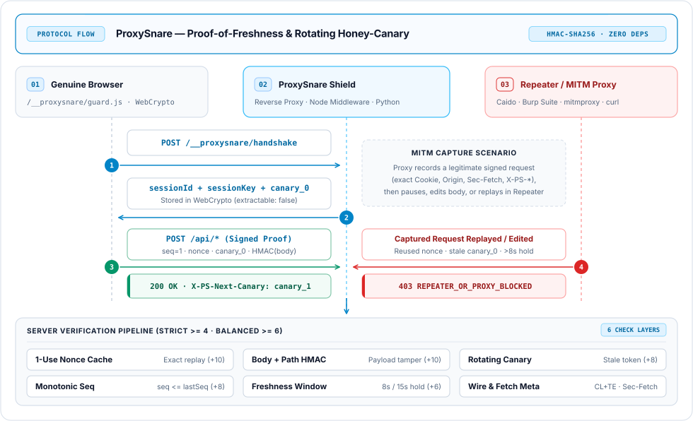

<p align="center">
  <picture>
    <source media="(prefers-color-scheme: dark)" srcset="assets/proxysnare-hero-dark.svg" />
    <source media="(prefers-color-scheme: light)" srcset="assets/proxysnare-hero-light.svg" />
    
  </picture>
</p>

<h1 align="center">ProxySnare</h1>

<p align="center">
  <a href="https://github.com/HUSMUS9999/proxysnare"></a>
  <a href="#architecture"></a>
  <a href="#features"></a>
  <a href="#quickstart"></a>
  <a href="LICENSE"></a>
</p>

<p align="center">
  <a href="#quickstart">Quickstart</a> &middot;
  <a href="#benchmarks">Benchmarks</a> &middot;
  <a href="#architecture">Architecture</a> &middot;
  <a href="#modes--honest-boundaries">Threat Model</a> &middot;
  <a href="#documentation--ecosystem">Docs</a>
</p>

**ProxySnare** is a zero-dependency reverse-proxy shield, Express/Node.js middleware, drop-in browser guard, and Python stdlib verifier for defending browser-driven web APIs against HTTP repeaters, intercepting proxy replays, and request tampering.

## Problem & Solution

**Problem:** Intercepting HTTP proxies and request repeaters (Caido Repeater, Burp Suite Repeater, mitmproxy) capture a legitimate browser request — preserving its exact session `Cookie`, `Authorization`, `Origin`, `Sec-Fetch-*`, and CSRF token — then pause, edit JSON fields, and replay it at human pace. Standard CSRF guards, Fetch Metadata checks, and rate limiters cannot distinguish those replays from genuine browser clicks.

**Solution:** ProxySnare adds a drop-in guard (`/__proxysnare/guard.js`) that negotiates an ephemeral per-tab key, imports it into WebCrypto (`extractable: false`), serializes concurrent protected `fetch()` / async `XMLHttpRequest` calls, and signs every request with a single-use `HMAC-SHA256` Proof-of-Freshness bound to the exact method, path+query, body SHA-256, monotonic sequence number, asymmetric freshness window, and server-rotated honey-canary (`X-PS-Next-Canary`). Out-of-the-box Repeater replays, body edits, and intercept holds fail with `403`.

## Features

- **Single-Use Proof-of-Freshness (`PS1|`)**: Drop-in `/__proxysnare/guard.js` transparently wraps `fetch()` and async `XMLHttpRequest` (supporting concurrent `Promise.all` queues, `FormData`, `Blob`, `URL`, `Request`, and automatic 30-min session re-handshake) to sign `(method, path+query, SHA-256(body), seq, ts, nonce, canary)` with `HMAC-SHA256`.
- **Rotating Honey-Canary (`X-PS-Next-Canary`)**: Every clean server response rotates a per-session canary token; `guard.js` advances automatically while replayed requests submit the stale pre-rotation canary and are rejected.
- **Intercept-Hold Freshness Window**: Holding a captured request past `freshnessMs` (`8s` strict / `15s` balanced) triggers `INTERCEPT_HOLD_OR_STALE_REPLAY`.
- **Path Normalization & Wire Scoring**: Normalizes case, percent-encoding (`/%61pi`), repeated slashes (`//api`), dot-segments, matrix params, and absolute-form URIs before checking `protectedPaths`; flags `CL+TE` smuggling, duplicate `Host`, cross-site Fetch Metadata, and proxy artifact headers.
- **Natural-Language CLI & Full Node/Python Parity**: Wrap any backend with zero code changes (including gzip/brotli HTML injection), integrate as Express/Node.js middleware (safe before or after `express.json()`), or run the wire-compatible Python stdlib verifier (`python/proxysnare.py`).

---

## Quickstart

### 1. Clone & Launch Interactive Demo (Zero Dependencies, Node >= 20)

```bash
git clone https://github.com/HUSMUS9999/proxysnare.git
cd proxysnare
node bin/proxysnare.js demo --port 8088 --mode strict
```

### 2. Natural-Language CLI (`explain` & `ask`)

```bash
# Preview the exact command first (safe dry-run)
node bin/proxysnare.js explain "block http repeaters on http://localhost:3000 on port 8080"

# Shield your running app immediately (auto-injects /__proxysnare/guard.js into HTML)
node bin/proxysnare.js ask "block http repeaters on http://localhost:3000 on port 8080"

# Observe & score traffic without blocking (safe initial rollout)
node bin/proxysnare.js ask "watch for repeaters without blocking on http://localhost:3000 on port 8080"

# Launch the built-in interactive demo
node bin/proxysnare.js ask "show me a demo"
```

### 3. Standalone Reverse-Proxy Shield (Zero Code Changes)

Works in front of any backend (Node.js, Python, Go, Rust, PHP, Java) and automatically injects `<script src="/__proxysnare/guard.js"></script>` into HTML responses:

```bash
node bin/proxysnare.js protect \
  --target http://127.0.0.1:3000 \
  --port 8080 \
  --mode strict \
  --paths /api,/auth,/checkout
```

### 4. Express / Node.js Middleware & Python Stdlib Verifier

```js
const express = require("express");
const { createProxySnareMiddleware } = require("./src/index.js");

const app = express();

// Works safely after express.json({ verify }) OR mounted directly before route handlers
app.use(express.json({ verify: (req, _res, buf) => { req.rawBody = buf; } }));
app.use(
  createProxySnareMiddleware({
    mode: "strict",              // "off" | "monitor" | "balanced" | "strict"
    protectedPaths: ["/api", "/checkout"],
    freshnessMs: 8000,
    exposeDebugHeaders: false,   // omit X-ProxySnare-Score / reason arrays in production
    onDetect: (ev) => console.warn("[ProxySnare]", ev.blocked ? "BLOCKED" : "FLAG", ev.reasons),
  })
);
// Remember to include <script src="/__proxysnare/guard.js"></script> in your HTML templates.
```

```python
import sys
sys.path.insert(0, "python")
from proxysnare import ProxySnareVerifier

verifier = ProxySnareVerifier(mode="strict", protected_paths=["/api"])

# 1. Serve POST /__proxysnare/handshake -> verifier.issue_session(ip=..., user_agent=..., origin=...)
# 2. On protected routes (e.g. Flask/FastAPI):
verdict = verifier.inspect_request(
    method=request.method,
    url=raw_path_with_query,   # exact path + query string (no trailing '?' if empty)
    headers=dict(request.headers),
    body=raw_body_bytes,
)
if verdict.blocked:
    return 403, {"error": "REPEATER_OR_PROXY_BLOCKED"}
# 3. Always attach verdict.next_canary to the response header `X-PS-Next-Canary`!
```

---

## Benchmarks

Measured live over local TCP/HTTP keep-alive sockets (`node benchmarks/run_unbiased_benchmark.js`, raw data in [`benchmarks/results.json`](benchmarks/results.json)): 400-request global pre-warmup + 100 warmup + 300 measured sequential POSTs per defense (no HMAC computation billed to non-HMAC baselines), plus 2 genuine browser requests and 6 live attack scenarios. **Unique Flood** sends 75 unique fresh valid requests (testing true flood throttling, not duplicate nonce replays).

### 1. Attack Detection Matrix (`0/2` false positives across all defenses)

| Defense | CSRF | Exact Replay | Body Tamper | 8.3s Hold | Proxy Strip | Unique Flood | Blocked |
| :--- | :-: | :-: | :-: | :-: | :-: | :-: | :-: |
| **Unprotected Node.js API** | `200` | `200` | `200` | `200` | `200` | `200` | `0/6` |
| **Double-Submit CSRF Guard** | **403** | `200` | `200` | `200` | `200` | `200` | `1/6` |
| **Rate Limiter (`60/min/IP`)** | `200` | `200` | `200` | `200` | `200` | **429** | `1/6` |
| **Fetch Metadata + Origin** | **403** | `200` | `200` | `200` | **403** | `200` | `2/6` |
| **Stateless HMAC (`30s` TTL)** | **403** | `200` | **403** | `200` | **403** | `200` | `3/6` |
| **HMAC (`8s` TTL) + Nonce Cache** | **403** | **403** | **403** | **403** | **403** | `200` | `5/6` |
| **ProxySnare (`balanced`, `15s`)** | **403** | **403** | **403** | `200`* | **403** | `200` | `4/6` |
| **ProxySnare (`strict`, `8s`)** | **403** | **403** | **403** | **403** | **403** | `200` | `5/6` |

*\*`balanced` deliberately allows an 8.3s hold inside its 15s mobile freshness window. Neither ProxySnare nor HMAC+Nonce is a rate limiter — pair with a rate limiter (`429`) to throttle unique-request floods.*

### 2. Latency, Throughput & Trade-Offs

| Defense | Median / p95 | Throughput | Client JS? | M2M APIs? | Honest Trade-Off |
| :--- | :-: | :-: | :-: | :-: | :--- |
| **Unprotected Node.js API** | `0.197 / 0.317 ms` | `4,639 req/s` | No | **Yes** | Baseline control; zero defense |
| **Double-Submit CSRF Guard** | `0.136 / 0.261 ms` | `6,124 req/s` | No | No | Stops CSRF only; Repeater keeps cookie+header |
| **Rate Limiter (`60/min/IP`)** | `0.196 / 0.252 ms` | `4,824 req/s` | No | **Yes** | Stops unique floods (`429`); misses slow Repeater edits |
| **Fetch Metadata + Origin** | **`0.089 / 0.153 ms`** | **`10,366 req/s`** | No | No | Zero client JS; misses captured Repeater headers |
| **Stateless HMAC (`30s` TTL)** | `0.121 / 0.219 ms` | `7,463 req/s` | Yes | **Yes** | Fast & M2M-ready; allows exact replay within 30s TTL |
| **HMAC (`8s` TTL) + Nonce** | `0.124 / 0.211 ms` | `7,439 req/s` | Yes | **Yes** | Strong & fast when client/server share a pre-provisioned key; no HTML auto-injection or canary/wire scoring |
| **ProxySnare (`balanced`)** | `0.206 / 0.315 ms` | `4,449 req/s` | Yes | No | Zero-code-change HTML guard + 15s window; requires sticky sessions on multi-worker clusters |
| **ProxySnare (`strict`)** | `0.193 / 0.297 ms` | `4,841 req/s` | Yes | No | Zero-code-change browser Repeater defense + rotating canary + wire checks; pair with rate limiting |

### Live Verification: Caido Repeater `0.59.1` vs. Chrome `158`

Measured against `node bin/proxysnare.js demo --mode strict`:

| Client / Attack Scenario | Status | Score | Triggered Signals |
| :--- | :-: | :-: | :--- |
| **Unmodified Chrome 158 (Click 1 & Click 2)** | **200** | `0 / 4` | None (canary auto-rotates on Click 2) |
| **Caido `0.59.1` — Exact Replay** | **403** | `32 / 4` | `REPEATER_NONCE_REPLAYED`, `REPEATER_SEQ_REPLAY`, `INTERCEPT_HOLD_OR_STALE_REPLAY`, `REPEATER_STALE_CANARY` |
| **Caido `0.59.1` — Edited Body (`42 -> 999999`) + Bumped Seq/Nonce** | **403** | `24 / 4` | `INTERCEPT_HOLD_OR_STALE_REPLAY`, `REPEATER_STALE_CANARY`, `REPEATER_BODY_OR_PATH_TAMPERED` |
| **Caido `0.59.1` — Stripped `X-PS-*` & `Sec-Fetch-*` + `Connection: close`** | **403** | `15 / 4` | `FETCH_METADATA_MISSING`, `REPEATER_CONNECTION_CLOSE`, `REPEATER_PROOF_MISSING` |

---

## Architecture

<p align="center">
  <picture>
    <source media="(prefers-color-scheme: dark)" srcset="assets/proxysnare-arch-dark.svg" />
    <source media="(prefers-color-scheme: light)" srcset="assets/proxysnare-arch-light.svg" />
    
  </picture>
</p>

---

## Modes & Honest Boundaries

| Mode | Threshold | Freshness Window | Action | Recommended Use |
| :--- | :-: | :-: | :--- | :--- |
| **`monitor`** | `6` *(logs only)* | `15,000 ms` | Sets debug headers, never blocks | Initial production rollout & SIEM tuning |
| **`balanced`** | `>= 6` | `15,000 ms` | Blocks replays, tampering & missing proofs | Consumer apps with slower mobile networks |
| **`strict`** *(default)* | `>= 4` | `8,000 ms` | Tightest replay, edit & intercept-hold defense | Checkout, auth, high-value browser APIs |
| **`off`** | Disabled | — | Pass-through | Local dev / automated API tests |

### Important Security & Operational Caveats
- **Handshake Key Exposure to Active MITM Plugins:** `/__proxysnare/handshake` transmits `sessionKeyHex` inside the TLS response before `guard.js` imports it into WebCrypto (`extractable: false`). Importing as non-extractable prevents *post-handshake in-page JS* (e.g. later XSS) from reading the key, and breaks all out-of-the-box Caido/Burp Repeater/Intruder replay workflows. However, a motivated attacker writing a custom Caido/Burp extension that captures `/handshake` (or calls `/handshake` directly with a matching browser UA) can compute valid signatures live. Always enforce real server-side authorization and business rules alongside ProxySnare.
- **Secure Context Required:** Browser WebCrypto (`crypto.subtle`) requires `https://` in production (or `http://localhost` / `http://127.0.0.1` locally).
- **Serialized Protected Requests:** `guard.js` queues concurrent protected requests (`Promise.all`) per tab so the single-step rotating canary never self-blocks.
- **Single-Process State & Floods:** Default session/nonce stores live in process-local Maps (enable sticky sessions behind multi-worker load balancers), and unique-request floods require a separate rate limiter.

---

## Testing & Reproducing Benchmarks

```bash
# Run zero-dependency Node.js + Python wire-parity test suite
npm test

# Reproduce the 8-defense live HTTP benchmark (writes benchmarks/results.json)
node benchmarks/run_unbiased_benchmark.js
```

## Documentation & Ecosystem

- **[Beginner's Natural-Language Guide](docs/getting-started-beginners.md)** — Walkthroughs, plain-English CLI recipes, and rollout checklist.
- **[Architecture, Signal Weights & Threat Model](docs/architecture-and-threat-model.md)** — Complete 19-signal reference and honest boundary analysis.

Companion repositories:
- **[Vibe-Slayer](https://github.com/HUSMUS9999/vibe-slayer)** — Zero-dependency Rust + C99 asset, binary, Web Component, and zero-geometry 3D stream protection platform.
- **[VeilBreak](https://github.com/HUSMUS9999/veilbreak)** — Zero-dependency anti-stealth & multi-engine browser integrity SDK, `<veil-break>` Web Component, middleware, and Python verifier.

---

## License

MIT License — see [LICENSE](LICENSE).
