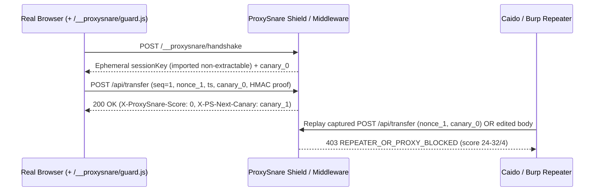

<p align="center">
  
</p>

<p align="center">
  <a href="docs/getting-started-beginners.md"></a>
  <a href="#live-verification-caido-repeater-0591-vs-chrome-158"></a>
  <a href="#installation--60-second-quickstart"></a>
  <a href="LICENSE"></a>
</p>

**Zero-dependency HTTP Repeater & Intercepting Proxy defense that detects and blocks Caido Repeater, Burp Suite Repeater, mitmproxy, and manual HTTP request tampering/replays in real time — with zero false positives for normal browsers.**

---

## Why ProxySnare Exists

Web security testing proxies like **Caido** and **Burp Suite** make trivial work of capturing a legitimate browser request, sending it to **Repeater**, tweaking JSON amounts/IDs/roles, and clicking **Send** 50 times in a row. Traditional WAFs cannot tell the difference between a real browser click and a Repeater replay because the `Cookie`, `Authorization`, and `User-Agent` headers are identical.

**ProxySnare breaks the Repeater workflow at the protocol layer**:
1. **Single-Use Cryptographic Proof-of-Freshness (PoF)**: A 1-line drop-in browser guard (`/__proxysnare/guard.js`) imports an ephemeral session key into non-extractable WebCrypto (`extractable: false`) and transparently signs every protected `fetch()` and async `XMLHttpRequest` with `HMAC-SHA256` over `(method, path+query, SHA-256(body), seq, ts, nonce, canary)`.
2. **Rotating Honey-Canary**: Every clean server response rotates `X-PS-Next-Canary`. Real browsers advance automatically; **Repeater replays the stale pre-rotation canary** and gets flagged immediately.
3. **Intercept-Hold Freshness Window**: Pausing a request in Caido Intercept or Burp Intercept past `freshnessMs` triggers `INTERCEPT_HOLD_OR_STALE_REPLAY`.
4. **Wire & Fetch-Metadata Anomaly Scoring**: Catches proxy artifact headers (`Proxy-Connection`, `X-Burp-*`, `X-Caido-*`), missing browser Fetch Metadata (`Sec-Fetch-Site`/`Sec-Fetch-Mode`), HTTP/1.1 `Connection: close` anomalies, OS Client-Hint lies, and `CL+TE` smuggling.

---

## Easiest Way to Start: Plain English (`ask` & `explain`)

Even complete beginners can protect any web app in 10 seconds using plain English:

```bash
# Preview the exact command without starting anything
node bin/proxysnare.js explain "block caido and burp repeater on http://localhost:3000 on port 8080"

# Shield your running app immediately (auto-injects /__proxysnare/guard.js into HTML!)
node bin/proxysnare.js ask "block caido and burp repeater on http://localhost:3000 on port 8080"

# Observe & score Repeater traffic without blocking (safe rollout mode)
node bin/proxysnare.js ask "watch for burp repeater without blocking on http://localhost:3000 on port 8080"

# Run the built-in interactive demo right now
node bin/proxysnare.js ask "show me a demo"
```

Read the full **[Beginner's Guide](docs/getting-started-beginners.md)** for step-by-step walkthroughs.

---

## Architecture



---

## Live Verification: Caido Repeater `0.59.1` vs. Chrome `158`

Empirically tested against the live ProxySnare strict demo server (`proxysnare demo --mode strict`):

| Client / Attack Scenario | HTTP Status | `X-ProxySnare-Score` | Triggered Signals |
| :--- | :---: | :---: | :--- |
| **Unmodified Google Chrome 158 (Click 1)** | **`200 OK`** | **`0 / 4`** | None (`0` false positives) |
| **Unmodified Google Chrome 158 (Click 2, auto-rotated canary)** | **`200 OK`** | **`0 / 4`** | None (`0` false positives) |
| **Caido `0.59.1` Repeater — Exact Replay of Captured Request** | **`403 Forbidden`** | **`32 / 4`** | `REPEATER_NONCE_REPLAYED`, `REPEATER_SEQ_REPLAY`, `INTERCEPT_HOLD_OR_STALE_REPLAY`, `REPEATER_STALE_CANARY` |
| **Caido `0.59.1` Repeater — Body Edited (`42 -> 999999`) + Fresh Nonce** | **`403 Forbidden`** | **`24 / 4`** | `INTERCEPT_HOLD_OR_STALE_REPLAY`, `REPEATER_STALE_CANARY`, `REPEATER_BODY_OR_PATH_TAMPERED` |
| **Caido `0.59.1` Repeater — Stripped `X-PS-*` Headers + `Connection: close`** | **`403 Forbidden`** | **`15 / 4`** | `FETCH_METADATA_MISSING`, `REPEATER_CONNECTION_CLOSE`, `REPEATER_PROOF_MISSING` |

---

## Installation & 60-Second Quickstart

### Option 1: Standalone Reverse-Proxy Shield (Zero Code Changes!)

Works in front of **any** backend (Node.js, Python, Go, Rust, PHP, Java) and automatically injects `<script src="/__proxysnare/guard.js"></script>` into HTML pages:

```bash
node bin/proxysnare.js protect \
  --target http://127.0.0.1:3000 \
  --port 8080 \
  --mode strict \
  --paths /api,/auth,/checkout
```

### Option 2: Express / Node.js HTTP Middleware

```js
const express = require("express");
const { createProxySnareMiddleware } = require("proxysnare");

const app = express();

// Recommended with express.json(): capture rawBody so whitespace-exact SHA-256 matches!
app.use(
  express.json({
    verify: (req, _res, buf) => {
      req.rawBody = buf;
    },
  })
);

app.use(
  createProxySnareMiddleware({
    mode: "strict", // "off" | "monitor" | "balanced" | "strict"
    protectedPaths: ["/api", "/checkout"],
    freshnessMs: 8000,
    onDetect: (ev) => console.warn("[ProxySnare]", ev.blocked ? "BLOCKED" : "FLAG", ev.reasons),
  })
);

app.post("/api/transfer", (req, res) => {
  res.json({ ok: true, score: req.proxySnare.score, body: req.body });
});
```

Add one tag in your HTML `<head>`:

```html
<script src="/__proxysnare/guard.js"></script>
```

### Option 3: Python Stdlib Verifier (`python/proxysnare.py`)

Wire-compatible zero-dependency Python 3.10+ verifier implementing the exact same `PS1|` HMAC-SHA256 + rotating-canary protocol:

```python
from proxysnare import ProxySnareVerifier

verifier = ProxySnareVerifier(mode="strict", protected_paths=["/api"])
verdict = verifier.inspect_request(method=req.method, url=req.full_path, headers=dict(req.headers), body=req.body)
if verdict.blocked:
    return 403, {"error": "REPEATER_OR_PROXY_BLOCKED", "reasons": [r["code"] for r in verdict.reasons]}
```

---

## Modes & Detection Reference

| Mode | Threshold | Freshness Window | Action | Recommended Use |
| :--- | :---: | :---: | :--- | :--- |
| **`monitor`** | Logs only | `15,000 ms` | Sets `X-ProxySnare-Score`, never blocks | Initial production rollout & SIEM tuning |
| **`balanced`** | `score >= 6` | `15,000 ms` | Blocks clear Repeater replays & tampering | Consumer apps with slower mobile networks |
| **`strict`** *(default)* | `score >= 4` | `8,000 ms` | Blocks replays, edits, intercept holds & missing proofs | High-value APIs, checkout, auth, anti-scraping |
| **`off`** | Disabled | — | Pass-through | Local dev / automated API integration tests |

Read **[Architecture, Signal Weights & Honest Threat Model](docs/architecture-and-threat-model.md)** for every signal code and an unbiased discussion of what ProxySnare does and does not block.

---

## Run Tests

```bash
npm test
```

## Related Projects

- **[Vibe-Slayer](https://github.com/HUSMUS9999/vibe-slayer)** — Zero-dependency Rust + C99 asset, binary, Web Component, and zero-geometry 3D stream protection platform.
- **[VeilBreak](https://github.com/HUSMUS9999/veilbreak)** — Universal zero-dependency anti-stealth & multi-engine browser integrity SDK, `<veil-break>` Web Component, middleware, and Python verifier.
