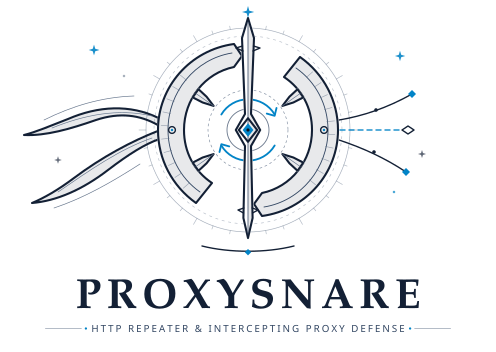

<p align="center">
  <picture>
    <source media="(prefers-color-scheme: dark)" srcset="assets/proxysnare-hero-dark.svg" />
    <source media="(prefers-color-scheme: light)" srcset="assets/proxysnare-hero-light.svg" />
    
  </picture>
</p>

<h1 align="center">ProxySnare</h1>

<p align="center">
  <a href="https://github.com/HUSMUS9999/proxysnare"></a>
  <a href="#architecture"></a>
  <a href="#features"></a>
  <a href="#quickstart"></a>
  <a href="LICENSE"></a>
</p>

<p align="center">
  <a href="#quickstart">Quickstart</a> &middot;
  <a href="#benchmarks">Benchmarks</a> &middot;
  <a href="#architecture">Architecture</a> &middot;
  <a href="#modes--honest-boundaries">Presets &amp; Threat Model</a> &middot;
  <a href="#documentation--ecosystem">Docs</a>
</p>

**ProxySnare** is a zero-dependency reverse-proxy shield, Express/Node.js middleware, drop-in browser guard, unified **ProxySnare + VeilBreak** shield, and pure-stdlib Python verifier for defending browser-driven web APIs against `curl`, HTTP repeaters (Caido, Burp Suite), intercepting proxy replays, DevTools Console `fetch()` tampering, Firecrawl/AI scrapers, and automated browsers.

## Problem & Solution

**Problem:** Intercepting HTTP proxies and request repeaters (Caido Repeater, Burp Suite Repeater, mitmproxy) capture a legitimate browser request — preserving its exact session `Cookie`, `Authorization`, `Origin`, `Sec-Fetch-*`, and CSRF token — then pause, edit JSON fields, and replay it at human pace. Sophisticated attackers also open DevTools Console to invoke `fetch()` directly inside the page, use Match & Replace to tamper with client guard scripts, attempt active ECDH MITM substitution, or run Firecrawl/headless browser scrapers.

**Solution:** ProxySnare injects a static SRI-pinned guard (`/__proxysnare/guard.js?v=<hash12>`, `integrity="sha384-..."`) that completes an **ECDSA P-256 authenticated `PS_ECDH_V2` + `PS_HS_AUTH_V1` handshake** bound to a single-use `(ip, ua)`-bound boot token, SHA-256 Proof-of-Work (`PS_POW_V2`), runtime `guardHash`, active CDP state, and (in unified mode) a challenge-bound **VeilBreak `VB_HS_V3`** real-browser integrity proof. The derived HMAC session key never crosses HTTP in plaintext and stays non-extractable inside captured native WebCrypto primitives. Every protected `fetch()` and async `XMLHttpRequest` is signed with a single-use `PS2|` `HMAC-SHA256` Proof-of-Freshness binding method, path+query, body SHA-256, monotonic sequence, freshness window, rotated honey-canary (`X-PS-Next-Canary`), and signed runtime provenance (`X-PS-Ctx`). Five adjustable presets (`off`, `monitor`/`observe`, `balanced`, `strict`, `paranoid`) let every team dial the exact availability-vs-security balance they need.

## Features

- **ECDSA-Authenticated `PS_ECDH_V2` + `PS_HS_AUTH_V1` + `hsBind`**: Browser WebCrypto verifies the server's deterministic ECDSA P-256 handshake signature (pinned inside SRI-protected `guard.js`) covering `(sessionId, clientPub, serverPub, salt, bootToken, serverNowMs, canary, hsBind)` BEFORE deriving the non-extractable `HMAC-SHA256` key via `HKDF-SHA256` — defeating passive capture, active MITM ECDH substitution, clock-shift attacks, and in-flight scrubbing of `cdpActive`/`browserProof`, with bit-for-bit Minerva-hardened pure-stdlib P-256 parity in `python/proxysnare.py`.
- **Static SRI + Full-Closure `guardHash` + Cross-Realm Native Integrity**: Serves immutable content-hashed `/__proxysnare/guard.js?v=<hash12>` with `sha384` SRI (`Cache-Control: public, max-age=31536000, immutable, no-transform`) and verifies a runtime `guardHash` over the entire `__psGuardMain` closure (`SERVER_ECDSA_PUB`, config flags, intrinsic capture, CDP/console-eval, handshake, fetch/XHR wrappers) plus cross-realm native `SubtleCrypto`, `Promise`, iterator, and load-time I/O checks at `/handshake` — while staying 0-FP on Angular `zone.js` (`ZoneAwarePromise`/`ZoneAwareError`) and post-load RUM/CMP wrappers.
- **Signed Provenance (`PS2|` `X-PS-Ctx`), Active CDP Fingerprinting & DevTools Console Detection**: Signs `(ce, cdp, ug, ga, ik)` inside the per-request HMAC using monotonic clocks and captured intrinsics — detecting DevTools Console / CDP `Runtime.evaluate` `fetch()` calls, active CDP sessions, and (in `paranoid` mode) non-gesture mutations while keeping `balanced`, `strict + allowDevTools: true`, and `strict + blockCdpActive: false` cleanly configurable with zero false positives for human developers, mobile roaming, and screen readers.
- **Firecrawl & AI-Crawler Defense + 1-Line Unified ProxySnare + VeilBreak Shield (`proxysnare/unified`)**: Blocks `Firecrawl`, `Apify`, `Browserless`, `Stagehand`, `GPTBot`, `ClaudeBot`, `x-firecrawl-*`, etc. by default (`blockAiCrawlers: false` to opt out). `createUnifiedShield()` / `createUnifiedMiddleware()` serves ONE SRI-pinned combined bundle embedding VeilBreak inside ProxySnare's private lexical closure (unreachable from `window` / `Symbol.for` / `MutationObserver`) with zero extra per-request ticket round trips.
- **Modular Subpath Exports, Bundled `.d.ts`, Replayable Express/Raw-Node Streams & Natural-Language CLI**: Import `proxysnare/presets`, `proxysnare/detector`, `proxysnare/middleware`, `proxysnare/browser-guard`, `proxysnare/unified`, or `proxysnare/nl` with TypeScript declarations; compatible with `express.json()`, `express.urlencoded({ extended: true })`, `express.raw()`, `multer`, `busboy`, `app.set("trust proxy", ...)`, and raw `http.createServer`.

---

## Quickstart

### 1. Clone & Launch Interactive Demo (Zero Dependencies, Node >= 20)

```bash
git clone https://github.com/HUSMUS9999/proxysnare.git
cd proxysnare
node bin/proxysnare.js demo --port 8088 --mode strict
```

### 2. Natural-Language CLI (`explain` & `ask`)

```bash
# Preview the exact command first (safe dry-run)
node bin/proxysnare.js explain "block caido/burp repeater on http://localhost:3000 on port 8080"

# Shield your running app immediately (auto-injects /__proxysnare/guard.js into HTML)
node bin/proxysnare.js ask "block caido/burp repeater on http://localhost:3000 on port 8080"

# Observe & score traffic without blocking (safe initial rollout)
node bin/proxysnare.js ask "watch for repeaters without blocking on http://localhost:3000 on port 8080"

# Behind Nginx / ALB / Cloudflare reverse proxy (supports IPv4/IPv6 CIDR trust lists)
node bin/proxysnare.js ask "block burp repeater on http://localhost:3000 on port 8080 behind nginx"
```

### 3. Standalone Reverse-Proxy Shield (Zero Code Changes)

Works in front of any backend (Node.js, Python, Go, Rust, PHP, Java) and automatically injects `<script src="/__proxysnare/guard.js"></script>` into HTML responses:

```bash
PROXYSNARE_SECRET="$(openssl rand -hex 32)" \
node bin/proxysnare.js protect \
  --target http://127.0.0.1:3000 \
  --port 8080 \
  --mode strict \
  --paths /api,/auth,/checkout \
  --trust-proxy 127.0.0.1,10.0.0.0/8 \
  --no-debug-headers
```

*Secrets can be supplied via `PROXYSNARE_SECRET` or `--secret-file <path>` (preferred over argv flags).*

### 4. Unified ProxySnare + VeilBreak Shield (Recommended for Maximum Browser + Anti-Repeater Defense)

Combines **ProxySnare** (anti-Repeater, ECDSA-authenticated ECDH, DevTools Console guard) + **VeilBreak** (15 cross-engine browser physics invariants, active CDP fingerprinting, Firecrawl/headless blocking) with **zero extra per-request ticket round trips**:

```js
const { createUnifiedShield } = require("proxysnare/unified");

// Single-pass reverse-proxy shield (auto-injects ONE SRI-pinned unified bundle embedding VeilBreak inside ProxySnare's private lexical closure)
const shield = createUnifiedShield({
  target: "http://127.0.0.1:3000",
  mode: "balanced",              // "off" | "monitor" | "balanced" | "strict" | "paranoid"
  protectedPaths: ["/api", "/checkout"],
  secret: process.env.PROXYSNARE_SECRET, // required across multi-worker clusters for identical SRI & ECDSA keys
  exposeDebugHeaders: false,
});
await shield.listen(8080);
```

### 5. Express / Node.js Middleware & Python Stdlib Verifier

```js
const express = require("express");
const { createProxySnareMiddleware } = require("proxysnare/middleware"); // or createUnifiedMiddleware from "proxysnare/unified"

const app = express();
app.set("trust proxy", 1); // automatically honored by ProxySnare & VeilBreak

const ps = createProxySnareMiddleware({
  mode: "balanced",              // start with "monitor" -> "balanced" -> "strict" -> "paranoid"
  protectedPaths: ["/api", "/checkout"],
  allowDevTools: false,          // set true in staging/strict to permit developers with DevTools open
  gestureExemptPaths: ["/api/heartbeat"], // exempt background POSTs when using mode: "paranoid"
  secret: process.env.PROXYSNARE_SECRET,
  exposeDebugHeaders: false,
  onDetect: (ev) => console.warn("[ProxySnare]", ev.blocked ? "BLOCKED" : "FLAG", ev.reasons),
});

// Works cleanly BEFORE express.json() / express.urlencoded({ extended: true }) / express.raw() / multer (restores readable stream),
// OR AFTER express.json({ verify: ps.captureRawBody })!
app.use(ps);
app.use(express.json());
// When using direct middleware, include <script src="/__proxysnare/guard.js?v=..." integrity="..."></script> (or unified.headTags()).
```

```python
import sys
sys.path.insert(0, "python")
from proxysnare import ProxySnareVerifier

verifier = ProxySnareVerifier(mode="strict", protected_paths=["/api"])

# 1. GET /__proxysnare/boot -> boot = verifier.issue_boot_challenge(ip=client_ip, user_agent=ua)
#    if boot is None: return 503, {"error": "BOOT_CAPACITY_EXCEEDED"}
# 2. POST /__proxysnare/handshake ->
#    ok, err = verifier.consume_boot_challenge(boot_token=..., pow_nonce=..., ip=client_ip, user_agent=ua)
#    sess = verifier.issue_session(ip=client_ip, user_agent=ua, origin=origin, client_pub_b64=client_pub_b64)
#    if sess is None: return 503, {"error": "SESSION_CAPACITY_EXCEEDED"}
# 3. On protected routes (thread-safe across Gunicorn/Waitress/FastAPI workers):
verdict = verifier.inspect_request(
    method=request.method,
    url=raw_path_with_query,     # exact path + query string (no trailing '?' if empty)
    headers=dict(request.headers),
    body=raw_body_bytes,
    ip=client_ip,
    raw_header_lines=raw_headers,  # enables duplicate Host / Content-Length / X-PS-* checks
    from_trusted_proxy=is_behind_nginx,
)
if verdict.rehandshake_recommended:
    response.headers["X-PS-Rehandshake"] = "1"
if verdict.blocked:
    return 403, {"error": "REPEATER_OR_PROXY_BLOCKED"}
if verdict.next_canary:
    response.headers["X-PS-Next-Canary"] = verdict.next_canary
```

---

## Benchmarks

Measured live over local TCP/HTTP keep-alive sockets (`node benchmarks/run_unbiased_benchmark.js`, Node `v22.23.2`, raw data in [`benchmarks/results.json`](benchmarks/results.json)): 400-request global pre-warmup + 100 warmup + 300 measured sequential POSTs interleaved across 3 rounds per defense (no client HMAC billed to non-HMAC baselines; ProxySnare uses the full `PS_ECDH_V2` + PoW handshake), plus 2 genuine browser requests and 6 live attack scenarios. **Unique Flood** sends 75 unique fresh valid requests (testing true flood throttling, not duplicate nonce replays).

### 1. Attack Detection Matrix (`0/2` false positives across all defenses)

| Defense | CSRF | Exact Replay | Body Tamper | 8.3s Hold | Proxy Strip | Unique Flood | Blocked |
| :--- | :-: | :-: | :-: | :-: | :-: | :-: | :-: |
| **Unprotected Node.js API** | `200` | `200` | `200` | `200` | `200` | `200` | `0/6` |
| **Double-Submit CSRF Guard** | **403** | `200` | `200` | `200` | `200` | `200` | `1/6` |
| **Rate Limiter (`60/min/IP`)** | `200` | `200` | `200` | `200` | `200` | **429** | `1/6` |
| **Fetch Metadata + Origin** | **403** | `200` | `200` | `200` | **403** | `200` | `2/6` |
| **Stateless HMAC (`30s` TTL)** | **403** | `200` | **403** | `200` | **403** | `200` | `3/6` |
| **HMAC (`8s` TTL) + Nonce Cache** | **403** | **403** | **403** | **403** | **403** | `200` | `5/6` |
| **ProxySnare (`balanced`, `15s`)** | **403** | **403** | **403** | `200`* | **403** | `200` | `4/6` |
| **ProxySnare (`strict`, `8s`)** | **403** | **403** | **403** | **403** | **403** | `200` | `5/6` |

*\*`balanced` deliberately allows an 8.3s hold inside its 15s mobile freshness window. Neither ProxySnare nor HMAC+Nonce is a rate limiter — pair with a rate limiter (`429`) to throttle unique-request floods.*

### 2. Latency, Throughput & Trade-Offs

| Defense | Median / p95 | Throughput | Client JS? | M2M APIs? | Honest Trade-Off |
| :--- | :-: | :-: | :-: | :-: | :--- |
| **Unprotected Node.js API** | `0.075 / 0.134 ms` | `11,392 req/s` | No | **Yes** | Baseline control; zero defense |
| **Double-Submit CSRF Guard** | `0.076 / 0.111 ms` | `11,817 req/s` | No | No | Stops CSRF only; Repeater keeps cookie+header |
| **Rate Limiter (`60/min/IP`)** | `0.076 / 0.103 ms` | **`12,005 req/s`** | No | **Yes** | Stops unique floods (`429`); misses slow Repeater edits |
| **Fetch Metadata + Origin** | `0.080 / 0.122 ms` | `11,654 req/s` | No | No | Zero client JS; misses captured Repeater headers |
| **Stateless HMAC (`30s` TTL)** | `0.111 / 0.172 ms` | `8,997 req/s` | Yes | **Yes** | Fast & M2M-ready; allows exact replay within 30s TTL |
| **HMAC (`8s` TTL) + Nonce** | `0.116 / 0.142 ms` | `8,463 req/s` | Yes | **Yes** | Fast when client/server share a pre-provisioned key; no HTML auto-injection or canary/wire scoring |
| **ProxySnare (`balanced`)** | `0.198 / 0.274 ms` | `4,924 req/s` | Yes | No | Zero-code-change HTML guard + `PS_ECDH_V2` (`3.92 ms` hs+10b PoW); sticky sessions on multi-worker clusters |
| **ProxySnare (`strict`)** | `0.199 / 0.263 ms` | `4,950 req/s` | Yes | No | Zero-code-change browser Repeater defense + `PS_ECDH_V2` (`32.81 ms` hs+12b PoW) + canary/wire checks; pair with rate limiting |

### Live Verification: Real Chrome & Firefox vs. `curl` & Caido Repeater

Verified end-to-end against live `mode=strict` reverse-proxy servers (`127.0.0.1`) with unmodified **Google Chrome 158**, **Mozilla Firefox 153 ESR**, `curl` (raw and spoofed Chrome UA), raw TCP path-bypass probes, and captured real-browser Repeater replays:

| Client / Scenario | Status | Score | Result / Signals |
| :--- | :-: | :-: | :--- |
| **Unmodified Chrome 158 & Firefox 153** (`fetch`, `Promise.all`, `302` redirect, `XHR` + `abort`) | **200** | `0 / 4` | Full `PS_ECDH_V2` key agreement (zero `sessionKeyHex` on wire); canary auto-rotates cleanly |
| **`curl` (raw or spoofed Chrome UA)** on `/api/*`, `/boot`, `/handshake` | **403** | `>= 6 / 4` | `NON_BROWSER_REPLAY_CLIENT` / `FETCH_METADATA_MISSING` / `REPEATER_PROOF_MISSING` |
| **Captured Browser Request — Exact Replay (Caido / Burp Repeater)** | **403** | `32 / 4` | `REPEATER_NONCE_REPLAYED`, `REPEATER_SEQ_REPLAY`, `REPEATER_STALE_CANARY` |
| **Captured Browser Request — Edited Body + Bumped Seq/Nonce** | **403** | `>= 18 / 4` | `REPEATER_STALE_CANARY`, `REPEATER_BODY_OR_PATH_TAMPERED` |
| **Path Bypass Probes** (`/%61pi`, `/api/%2e%2e/secret`, `/api%00`, `/api./`, `/api%20/`, `X-Original-URL`) | **403** | `>= 8 / 4` | Caught by multi-candidate path expansion & override header check |

---

## Architecture

<p align="center">
  <picture>
    <source media="(prefers-color-scheme: dark)" srcset="assets/proxysnare-arch-dark.svg" />
    <source media="(prefers-color-scheme: light)" srcset="assets/proxysnare-arch-light.svg" />
    
  </picture>
</p>

---

## Modes & Honest Boundaries

Choose the exact availability-vs-security balance for your audience (every knob can also be overridden individually):

| Preset | Threshold | Freshness | PoW | IP Bind | DevTools / Console | User Gesture on Mutate | Recommended Use |
| :--- | :-: | :-: | :-: | :-: | :--- | :-: | :--- |
| **`off`** | Disabled | — | `0` | Off | Allowed | Off | Local dev / automated API test suites |
| **`monitor`** *(alias: `observe`)* | `6` *(logs only)* | `15 s` | `0` | Off | Allowed | Off | Zero-risk rollout, SIEM tuning & baseline auditing |
| **`balanced`** | `>= 6` | `15 s` | `10 b` | **Off** *(mobile roaming safe)* | **DevTools allowed** *(zero FP)*; blocks Repeater, tampering, `curl`, Firecrawl & synthetic clicks | Off | **Best default for public consumer/mobile apps** |
| **`strict`** *(default)* | `>= 4` | `8 s` | `12 b` | On *(auto-rehandshakes on IP roam)* | Blocks active CDP & DevTools Console `fetch()`, SRI + `guardHash` enforced *(pass `allowDevTools: true` or `blockCdpActive: false` in dev/staging)* | Off | Checkout, auth, SaaS & high-value browser APIs |
| **`paranoid`** | `>= 4` | `5 s` | `14 b` | On | Hard-blocks active CDP & Console `fetch()`, requires signed `X-PS-Ctx` | **On** *(GET/HEAD & `gestureExemptPaths` exempt)* | High-risk financial / anti-cheat / anti-bot mutations |

*HTTP operational status codes: `403` (blocked / invalid boot token / guard mismatch / browser integrity failure), `413` (request body exceeds `maxBodyBytes`), `429` (per-IP boot or handshake rate limit exceeded), `503` (session or boot-token capacity limit reached — fails closed rather than evicting active sessions).*

### Honest Threat-Model Boundaries (Zero Bias)
- **What v2.1 Mitigates:**
  - **Bypass 1 (Browser DevTools Console `fetch()`):** Blocked in `strict`/`paranoid` via signed `PS2|` `X-PS-Ctx` stack provenance (using captured monotonic clocks & intrinsics; catches `Error.prepareStackTrace` tampering and `//# sourceURL=` spoofing).
  - **Bypass 2 (Caido Match & Replace on `/__proxysnare/guard.js`):** Blocked by static `sha384` SRI (`?v=<hash12>`), full-closure runtime `guardHash` over `__psGuardMain`, and cross-realm native `SubtleCrypto` / `Promise` / I/O integrity checks.
  - **Bypass 3 (Active MITM ECDH Key Substitution):** Blocked by deterministic ECDSA P-256 (`PS_HS_AUTH_V1` + `hsBind`) verified against pinned `SERVER_ECDSA_PUB` before deriving the HKDF key — also defeats in-flight MITM scrubbing of `cdpActive`/`browserProof` and clock shifting.
  - **Bypass 4 (Standalone 40-line `PS_ECDH_V2` Script & Firecrawl/AI Crawlers):** Defeated by Firecrawl/AI-crawler blocking plus `createUnifiedShield` binding VeilBreak's challenge-bound `VB_HS_V3` real-browser physics + Web Worker + active CDP proof directly into `/handshake`.
- **Irreducible Local-OS / Trusted-CA Boundary:** No pure-HTTP/JS defense can be "100% unbypassable" against an attacker who controls the client OS, installs their own MITM root CA, AND simultaneously rewrites **both** the HTML response (stripping `integrity="..."` and pinning their own `SERVER_ECDSA_PUB`) **and** `guard.js` — or drives a custom-compiled unmodified browser binary with human-like OS pointer events. Always enforce server-side authentication, authorization, rate limiting, and business invariants alongside ProxySnare.
- **Secure Context & Multi-Worker Deployment:** Browser WebCrypto (`crypto.subtle`) requires `https://` in production (or `http://localhost` / `http://127.0.0.1` locally). Always set a shared `PROXYSNARE_SECRET` across multi-worker clusters so all workers derive identical `SERVER_ECDSA_PUB`, `guardSri`, `guardVersion`, `guardHash`, and cross-worker stateless boot tokens; enable sticky sessions behind load balancers for process-local active sessions/nonces.
- **Serialized Protected Requests:** `guard.js` serializes protected requests per tab so the single-step rotating canary never self-blocks (aborting a queued request rejects immediately without breaking serialization). Keep long-lived SSE/streaming endpoints outside `protectedPaths`.

---

## Testing & Reproducing Benchmarks

```bash
# Run zero-dependency Node.js + Python wire-parity test suite
npm test

# Reproduce the 8-defense live HTTP benchmark (writes benchmarks/results.json)
node benchmarks/run_unbiased_benchmark.js
```

## Documentation & Ecosystem

- **[Beginner's Natural-Language Guide](docs/getting-started-beginners.md)** — Walkthroughs, plain-English CLI recipes, and rollout checklist.
- **[Architecture, Signal Weights & Threat Model](docs/architecture-and-threat-model.md)** — Complete `PS_ECDH_V2` handshake spec, signal reference, and honest boundary analysis.

Companion repositories:
- **[Vibe-Slayer](https://github.com/HUSMUS9999/vibe-slayer)** — Zero-dependency Rust + C99 asset, binary, Web Component, and zero-geometry 3D stream protection platform.
- **[VeilBreak](https://github.com/HUSMUS9999/veilbreak)** — Zero-dependency anti-stealth & multi-engine browser integrity SDK, `<veil-break>` Web Component, middleware, and Python verifier.

---

## License

MIT License — see [LICENSE](LICENSE).
