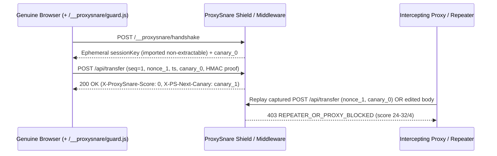

<p align="center">
  <picture>
    <source media="(prefers-color-scheme: dark)" srcset="assets/proxysnare-hero-dark.svg" />
    <source media="(prefers-color-scheme: light)" srcset="assets/proxysnare-hero-light.svg" />
    
  </picture>
</p>

<h1 align="center">ProxySnare</h1>

<p align="center">
  Zero-Dependency HTTP Repeater &amp; Intercepting Proxy Defense
</p>

<p align="center">
  <a href="https://github.com/HUSMUS9999/proxysnare/releases/tag/v1.0.0"></a>
  <a href="#architecture"></a>
  <a href="#features"></a>
  <a href="#quickstart"></a>
  <a href="LICENSE"></a>
</p>

**ProxySnare** is a zero-dependency reverse-proxy shield, Express/Node.js middleware, drop-in browser guard, and Python stdlib verifier that detects and blocks **HTTP repeaters, intercepting security proxies, request tampering, and replay attacks** in real time — with **0% false positives for genuine browsers**.

## Features

- **Single-Use Proof-of-Freshness (PoF)** — A 1-line drop-in guard (`/__proxysnare/guard.js`) imports an ephemeral session key into non-extractable WebCrypto (`extractable: false`) and transparently signs every protected `fetch()` and async `XMLHttpRequest` with `HMAC-SHA256` over `(method, path+query, SHA-256(body), seq, ts, nonce, canary)`
- **Rotating Honey-Canary (`X-PS-Next-Canary`)** — Every clean server response rotates a per-session canary token; real browsers advance automatically while replayed requests submit the stale pre-rotation canary and are blocked immediately
- **Intercept-Hold Freshness Window** — Holding a captured request in an intercepting proxy past `freshnessMs` triggers `INTERCEPT_HOLD_OR_STALE_REPLAY`
- **Wire & Fetch-Metadata Anomaly Scoring** — Detects proxy leakage headers (`Proxy-Connection`, proxy custom headers), missing browser Fetch Metadata (`Sec-Fetch-Site` / `Sec-Fetch-Mode`), HTTP/1.1 `Connection: close` anomalies, OS Client-Hint lies, and `CL+TE` smuggling
- **Natural-Language CLI (`ask` & `explain`) & Polyglot Middleware** — Wrap any backend with zero code changes, integrate as zero-dependency Express/Node.js middleware, or verify wire-compatibly in Python (`python/proxysnare.py`)

---

## Quickstart

### 1. Clone & Launch Interactive Demo (Zero Dependencies, Node >= 20)

```bash
git clone https://github.com/HUSMUS9999/proxysnare.git
cd proxysnare
node bin/proxysnare.js demo --port 8089 --mode strict
```

### 2. Natural-Language CLI (`explain` & `ask`)

```bash
# Preview the exact command first (safe dry-run)
node bin/proxysnare.js explain "block http repeaters on http://localhost:3000 on port 8080"

# Shield your running app immediately (auto-injects /__proxysnare/guard.js into HTML)
node bin/proxysnare.js ask "block http repeaters on http://localhost:3000 on port 8080"

# Observe & score traffic without blocking (safe rollout mode)
node bin/proxysnare.js ask "watch for repeaters without blocking on http://localhost:3000 on port 8080"

# Launch the built-in interactive demo
node bin/proxysnare.js ask "show me a demo"
```

### 3. Standalone Reverse-Proxy Shield (Zero Code Changes)

Works in front of **any** backend (Node.js, Python, Go, Rust, PHP, Java) and automatically injects `<script src="/__proxysnare/guard.js"></script>` into HTML pages:

```bash
node bin/proxysnare.js protect \
  --target http://127.0.0.1:3000 \
  --port 8080 \
  --mode strict \
  --paths /api,/auth,/checkout
```

### 4. Express / Node.js Middleware & Python Stdlib Verifier

```js
const express = require("express");
const { createProxySnareMiddleware } = require("proxysnare");

const app = express();

// Capture rawBody so whitespace-exact SHA-256 body verification matches
app.use(express.json({ verify: (req, _res, buf) => { req.rawBody = buf; } }));

app.use(
  createProxySnareMiddleware({
    mode: "strict", // "off" | "monitor" | "balanced" | "strict"
    protectedPaths: ["/api", "/checkout"],
    freshnessMs: 8000,
    onDetect: (ev) => console.warn("[ProxySnare]", ev.blocked ? "BLOCKED" : "FLAG", ev.reasons),
  })
);
```

```html
<script src="/__proxysnare/guard.js"></script>
```

```python
from python.proxysnare import ProxySnareVerifier

verifier = ProxySnareVerifier(mode="strict", protected_paths=["/api"])
verdict = verifier.inspect_request(method=req.method, url=req.full_path, headers=dict(req.headers), body=req.body)
if verdict.blocked:
    return 403, {"error": "REPEATER_OR_PROXY_BLOCKED", "reasons": [r["code"] for r in verdict.reasons]}
```

---

## Live Verification: Caido Repeater `0.59.1` vs. Chrome `158`

Empirically measured against the live ProxySnare strict demo server (`node bin/proxysnare.js demo --mode strict`):

| Client / Attack Scenario | HTTP Status | `X-ProxySnare-Score` | Triggered Signals |
| :--- | :---: | :---: | :--- |
| **Unmodified Google Chrome 158 (Click 1)** | **`200 OK`** | **`0 / 4`** | None (`0` false positives) |
| **Unmodified Google Chrome 158 (Click 2, auto-rotated canary)** | **`200 OK`** | **`0 / 4`** | None (`0` false positives) |
| **Caido `0.59.1` Repeater — Exact Replay of Captured Request** | **`403 Forbidden`** | **`32 / 4`** | `REPEATER_NONCE_REPLAYED`, `REPEATER_SEQ_REPLAY`, `INTERCEPT_HOLD_OR_STALE_REPLAY`, `REPEATER_STALE_CANARY` |
| **Caido `0.59.1` Repeater — Body Edited (`42 -> 999999`) + Fresh Nonce** | **`403 Forbidden`** | **`24 / 4`** | `INTERCEPT_HOLD_OR_STALE_REPLAY`, `REPEATER_STALE_CANARY`, `REPEATER_BODY_OR_PATH_TAMPERED` |
| **Caido `0.59.1` Repeater — Stripped `X-PS-*` Headers + `Connection: close`** | **`403 Forbidden`** | **`15 / 4`** | `FETCH_METADATA_MISSING`, `REPEATER_CONNECTION_CLOSE`, `REPEATER_PROOF_MISSING` |

---

## Architecture



---

## Modes & Detection Reference

| Mode | Threshold | Freshness Window | Action | Recommended Use |
| :--- | :---: | :---: | :--- | :--- |
| **`monitor`** | Logs only | `15,000 ms` | Sets `X-ProxySnare-Score`, never blocks | Initial production rollout & SIEM tuning |
| **`balanced`** | `score >= 6` | `15,000 ms` | Blocks clear Repeater replays & tampering | Consumer apps with slower mobile networks |
| **`strict`** *(default)* | `score >= 4` | `8,000 ms` | Blocks replays, edits, intercept holds & missing proofs | High-value APIs, checkout, auth, anti-scraping |
| **`off`** | Disabled | — | Pass-through | Local dev / automated API integration tests |

---

## Testing

```bash
npm test
```

## Documentation & Ecosystem

- **[Beginner's Natural-Language Guide](docs/getting-started-beginners.md)** — Step-by-step walkthroughs and copy-paste recipes.
- **[Architecture, Signal Weights & Threat Model](docs/architecture-and-threat-model.md)** — Every signal code, scoring weight, and honest boundary analysis.

Companion repositories:
- **[Vibe-Slayer](https://github.com/HUSMUS9999/vibe-slayer)** — Zero-dependency Rust + C99 asset, binary, Web Component, and zero-geometry 3D stream protection platform.
- **[VeilBreak](https://github.com/HUSMUS9999/veilbreak)** — Universal zero-dependency anti-stealth & multi-engine browser integrity SDK, `<veil-break>` Web Component, middleware, and Python verifier.

---

## License

MIT License — see [LICENSE](LICENSE).
